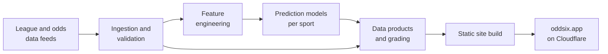

# Oddsix

A multi-sport data and prediction platform, live at **[oddsix.app](https://oddsix.app)**.
Designed, built and run by Spencer Goss. The source code is private; this repository documents the project.

## Features

- Live scores, standings and game pages for the NBA, NFL, MLB, NHL and soccer
- Team pages with strength ratings, recent form and advanced stats
- Career stats and game logs for about 57,000 players
- Historical record books for each league
- Model predictions for every game: win probability and projected score

## Architecture

- **Data:** league APIs and public odds feeds, ingested and validated continuously through the day
- **Storage:** relational databases and versioned data files, with large archives on Cloudflare R2
- **Models:** a separate model per sport, validated on seasons they were not trained on, with calibrated
  probabilities; predictions are graded publicly after each game
- **Front end:** Astro static site on Cloudflare Pages, with a single template serving the player pages
- **Quality:** thousands of automated tests run on every change

A new generation of models is being evaluated live this season.

## Stack

Python (pandas, scikit-learn, LightGBM) · SQL · Astro · TypeScript · Cloudflare Pages and R2

---

For information and entertainment only.
