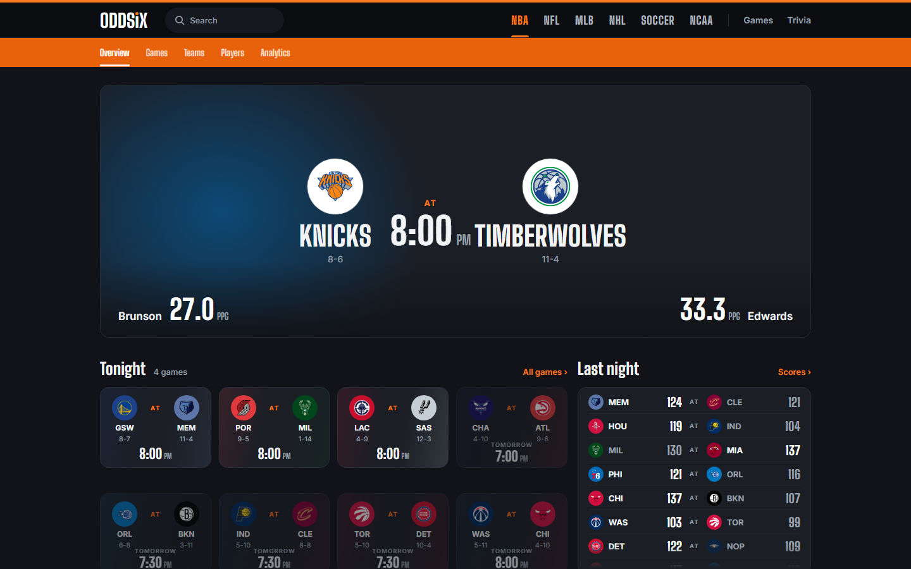
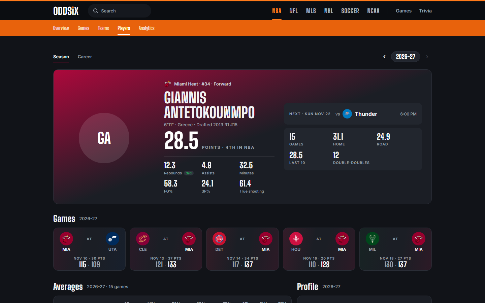
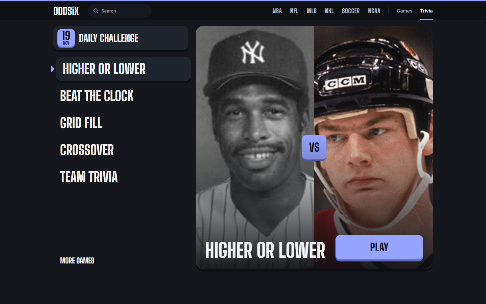
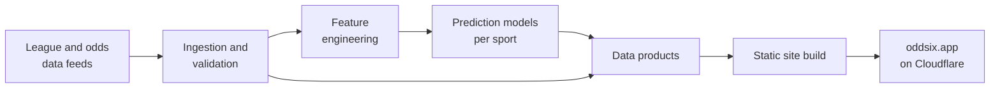

# Oddsix

A multi-sport data and prediction platform, live at **[oddsix.app](https://oddsix.app)**.
Designed, built and run by Spencer Goss. The source code is private; this repository documents the project.

## Features

- Live scores, standings and game pages for the NBA, NFL, MLB, NHL and soccer
- League overview pages: tonight's games, last night's scores, standings, stat leaders and player of the week
- Team pages with records, splits, recent games, efficiency stats and rosters
- Season and career stats, game logs and shot data for about 57,000 players
- Historical record books for each league
- Daily sports trivia games built on the same data (Higher or Lower, Beat the Clock, Grid Fill and more)
- A prediction model for each sport; a new generation of models is in live testing this season

## Architecture

- **Data:** league APIs and public odds feeds, ingested and validated continuously through the day
- **Storage:** relational databases and versioned data files, with large archives on Cloudflare R2
- **Models:** a separate model per sport, validated on seasons they were not trained on, with calibrated probabilities
- **Front end:** Astro static site on Cloudflare Pages, with one template serving every player page

## Stack

Python (pandas, scikit-learn, LightGBM) · SQL · Astro · TypeScript · Cloudflare Pages and R2

---

For information and entertainment only.
